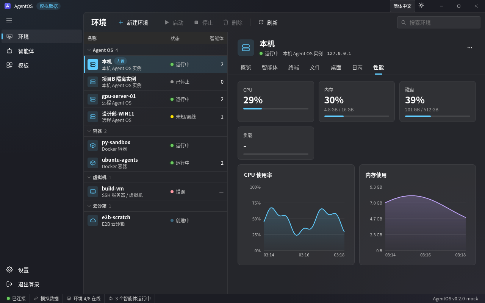
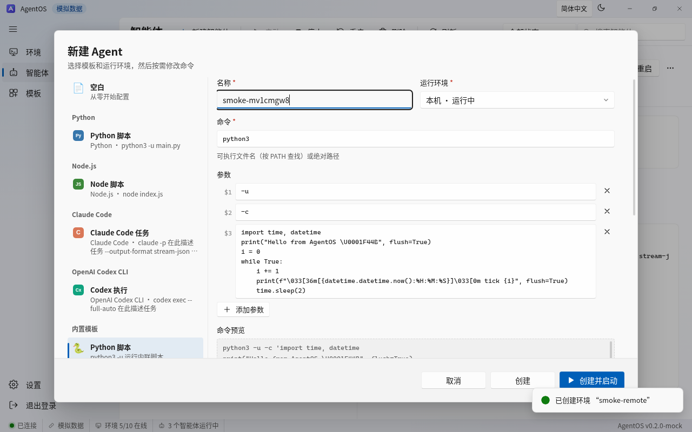

# AgentOS

**0.1.22** · 面向智能体的操作系统与桌面环境：管理运行环境、智能体进程、文件与远程桌面，用 Go 实现。

## 界面截图

以下为仓库已有的真实桌面界面。状态栏可见「模拟数据」和 `v0.2.0-mock`，因此这些图是**模拟/演示数据**，不是生产环境实况，也不是 Windows 安装包截图（本仓库没有 GitHub Release）。



*桌面深色界面（模拟数据） / Desktop, dark theme (mock data)*


*运行环境列表 / Environment list*



*智能体对话框 / Agent dialog*


*文件管理 / File manager*

## 功能特性

- 桌面客户端：环境、智能体、日志、性能与文件管理，支持深色主题与中英文界面。
- 多种环境提供方（含 Docker 桌面镜像）与本地虚拟机相关能力，见 `docs/local-vms.md`。
- HTTP API：环境、会话与智能体联邦等，文档在 `docs/`。
- 可用 Makefile 一键构建桌面端与命令行组件。

## 技术栈

- Go 1.27+
- 桌面端（见 `cmd/agentos-desktop`）
- 可选 Docker 环境镜像

## 从源码运行

源码在仓库根目录。本仓库不包含安装包。

```bash
# 依赖 Go 1.27+
make
# 或阅读 Makefile / README 中的具体目标
```
更完整的模块与 API 说明见下方文档。

## 文档

- [REST API](docs/api.md)
- [Server⇄Node 协议](docs/protocol.md)
- [模块划分](docs/modules.md)
- [docs/local-vms.md](docs/local-vms.md)
- [模块说明](docs/modules.md)
- [API](docs/api.md)
- [本地虚拟机](docs/local-vms.md)
- [桌面端](cmd/agentos-desktop/README.md)

## 贡献

欢迎通过 Issue 和 Pull Request 参与，详见 [CONTRIBUTING.md](CONTRIBUTING.md)。安全问题请按 [SECURITY.md](SECURITY.md) 私下报告。参与时请遵守 [CODE_OF_CONDUCT.md](CODE_OF_CONDUCT.md)。

## 许可证

本仓库尚未附带 LICENSE 文件，许可证未指定。

---

## English

# AgentOS

**0.1.22** · An operating environment and desktop for agents: manage runtimes, agent processes, files, and remote desktops. Implemented in Go.

## Screenshots

These are existing real desktop captures. The status bar shows mock/demo data and `v0.2.0-mock`. They are not production telemetry and not Windows-installer shots (no GitHub Release).


*桌面深色界面（模拟数据） / Desktop, dark theme (mock data)*


*运行环境列表 / Environment list*


*智能体对话框 / Agent dialog*


*文件管理 / File manager*

## Features

- Desktop client for environments, agents, logs, performance, and files; dark theme and Chinese/English UI.
- Multiple environment providers (including Docker desktop images) and local VM support; see `docs/local-vms.md`.
- HTTP APIs for environments, sessions, and agent federation; docs in `docs/`.
- Makefile targets build the desktop app and CLI components.

## Tech stack

- Go 1.27+
- 桌面端（见 `cmd/agentos-desktop`）
- 可选 Docker 环境镜像

## Getting started

Source is at the repository root. This repository does not include installers.

```bash
# Requires Go 1.27+
make
# Or use the specific targets documented in the Makefile / README
```
See the docs below for modules and APIs.

## Documentation

- [REST API](docs/api.md)
- [Server⇄Node 协议](docs/protocol.md)
- [模块划分](docs/modules.md)
- [docs/local-vms.md](docs/local-vms.md)
- [模块说明](docs/modules.md)
- [API](docs/api.md)
- [本地虚拟机](docs/local-vms.md)
- [桌面端](cmd/agentos-desktop/README.md)

## Contributing

Issues and pull requests are welcome. See [CONTRIBUTING.md](CONTRIBUTING.md). Please report vulnerabilities privately via [SECURITY.md](SECURITY.md). This project follows [CODE_OF_CONDUCT.md](CODE_OF_CONDUCT.md).

## License

No LICENSE file is included in this repository; the license is unspecified.
