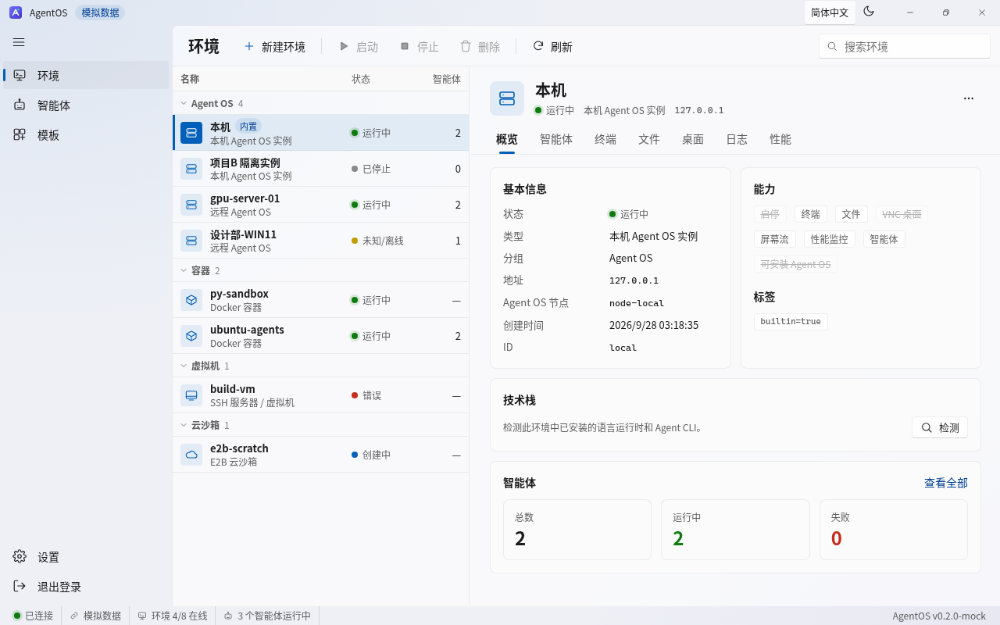
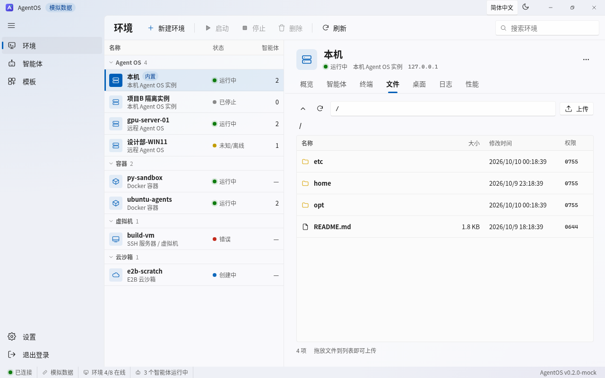

# AgentOS

**0.1.22** · 面向智能体的操作系统与桌面环境：管理运行环境、智能体进程、文件与远程桌面，用 Go 实现。

## 界面截图


*桌面深色界面 / Desktop, dark theme*



*运行环境列表 / Environment list*


*智能体对话框 / Agent dialog*



*文件管理 / File manager*

## 功能特性

- 桌面客户端：环境、智能体、日志、性能与文件管理，支持深色主题与中英文界面。
- 多种环境提供方（含 Docker 桌面镜像）与本地虚拟机相关能力，见 `docs/local-vms.md`。
- HTTP API：环境、会话与智能体联邦等，文档在 `docs/`。
- 可用 Makefile 一键构建桌面端与命令行组件。

## 技术栈

- Go 1.27+
- 桌面端（见 `cmd/agentos-desktop`）
- 可选 Docker 环境镜像

## 从源码运行

源码在仓库根目录。本仓库不包含安装包。

```bash
# 依赖 Go 1.27+
make
# 或阅读 Makefile / README 中的具体目标
```
更完整的模块与 API 说明见下方文档。

## 文档

- [源码 README](README.original.md)
- [模块说明](docs/modules.md)
- [API](docs/api.md)
- [本地虚拟机](docs/local-vms.md)
- [桌面端](cmd/agentos-desktop/README.md)

---

## English

# AgentOS

**0.1.22** · An operating environment and desktop for agents: manage runtimes, agent processes, files, and remote desktops. Implemented in Go.

## Screenshots


*桌面深色界面 / Desktop, dark theme*


*运行环境列表 / Environment list*


*智能体对话框 / Agent dialog*


*文件管理 / File manager*

## Features

- Desktop client for environments, agents, logs, performance, and files; dark theme and Chinese/English UI.
- Multiple environment providers (including Docker desktop images) and local VM support; see `docs/local-vms.md`.
- HTTP APIs for environments, sessions, and agent federation; docs in `docs/`.
- Makefile targets build the desktop app and CLI components.

## Tech stack

- Go 1.27+
- 桌面端（见 `cmd/agentos-desktop`）
- 可选 Docker 环境镜像

## Getting started

Source is at the repository root. This repository does not include installers.

```bash
# Requires Go 1.27+
make
# Or use the specific targets documented in the Makefile / README
```
See the docs below for modules and APIs.

## Documentation

- [源码 README](README.original.md)
- [模块说明](docs/modules.md)
- [API](docs/api.md)
- [本地虚拟机](docs/local-vms.md)
- [桌面端](cmd/agentos-desktop/README.md)

